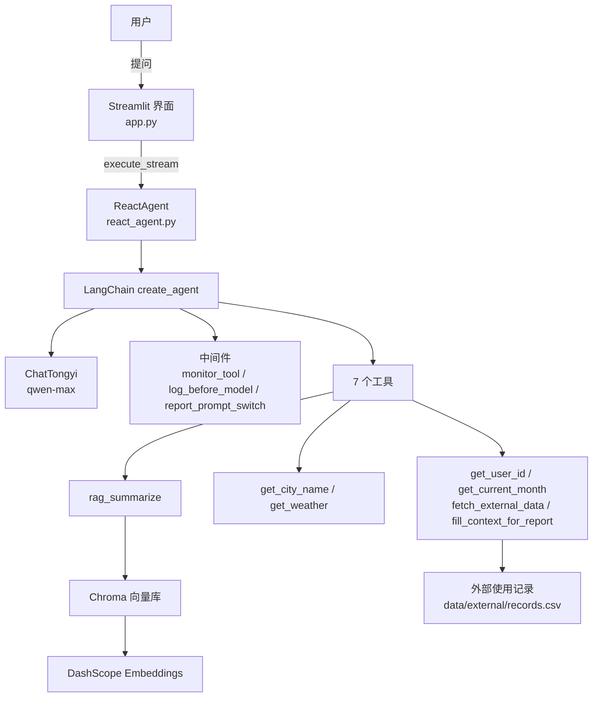
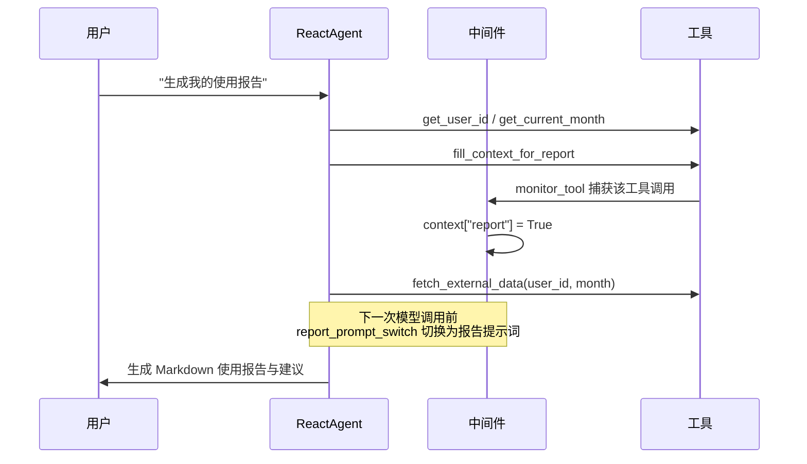

# Robot Vacuum Customer Service Agent

<p align="center">
  
  
  
  
  
</p>

<p align="center">
  基于 <b>LangChain ReAct Agent + RAG</b> 的扫地机器人智能客服系统<br>
  An intelligent customer-service agent for robot vacuums, built with LangChain, ReAct and RAG.
</p>

---

面向消费者（toC）的扫地机器人智能客服，覆盖产品全生命周期：售前咨询、售后使用指导、故障排查，以及基于使用数据的个性化报告生成。系统以通义千问（Qwen）为大脑，通过 ReAct 范式自主「思考 → 行动 → 观察 → 再思考」，按需调用工具并结合私有知识库（RAG）给出专业、可靠的回答。

## 功能特性

- **智能问答**：处理购买前咨询（功能、价格、对比）与购买后问题（操作、故障、维护），基于 RAG 从知识库检索准确信息作答。
- **使用报告生成**：分析用户使用记录（清洁效率、耗材状态、对比数据），生成个性化 Markdown 报告与优化建议。
- **ReAct 自主决策**：由大模型动态决定是否调用工具、调用哪个工具、是否继续迭代，而非写死的固定流程。
- **中间件增强**：工具调用监控日志、模型调用前日志，以及**报告场景下的提示词动态切换**。
- **增量知识库**：基于 MD5 去重，仅加载新增/变更文档，避免重复嵌入。
- **流式交互**：Streamlit 聊天界面，逐字符流式输出，会话历史保持。

## 系统架构



## 核心工作流程

报告生成场景通过中间件实现「问答人格」与「报告人格」的解耦：模型调用 `fill_context_for_report` 后，`monitor_tool` 将运行时上下文 `report` 置为 `True`，`@dynamic_prompt` 中间件在下一次模型调用前自动切换到报告提示词。



## 技术栈

| 领域 | 选型 |
|---|---|
| 智能体框架 | LangChain 1.4 `create_agent` + LangGraph |
| 大语言模型 | 通义千问 `qwen-max`（阿里云百炼 DashScope） |
| 嵌入模型 | DashScope `text-embedding-v4` |
| 向量数据库 | Chroma |
| 检索增强 | RecursiveCharacterTextSplitter + Retriever + 总结链 |
| Web 界面 | Streamlit |
| 配置/提示词 | YAML 配置 + 独立提示词模板文件 |

## 项目结构

```
robot-vacuum-customer-service/
├── app.py                      # Streamlit 入口，聊天界面与流式输出
├── agent/
│   ├── react_agent.py          # ReactAgent：装配模型/工具/中间件，流式执行
│   └── tools/
│       ├── agent_tools.py      # 7 个工具函数
│       └── middleware.py       # 3 个中间件（监控/日志/提示词切换）
├── model/
│   └── factory.py              # 模型工厂：ChatModel + EmbeddingModel
├── rag/
│   ├── rag_service.py          # 检索 + 总结服务
│   └── vector_store.py         # Chroma 向量库，MD5 增量加载文档
├── utils/
│   ├── cofig_handler.py        # YAML 配置加载
│   ├── prompt_loader.py        # 提示词加载
│   ├── file_handler.py         # PDF/TXT 加载、MD5、目录遍历
│   ├── logger_handler.py       # 统一日志
│   └── path_tool.py            # 项目绝对路径工具
├── config/                     # YAML 配置（agent/rag/chroma/prompts）
├── prompts/                    # 提示词模板（主/RAG/报告）
├── data/                       # 知识库源文件（txt/pdf）+ 外部使用记录 csv
├── docs/                       # 设计文档
├── requirements.txt
├── .env.example
├── LICENSE
└── README.md
```

> `chroma_db/`（向量库）、`logs/`（日志）、`md5.text`（去重记录）为运行时生成的产物，已在 `.gitignore` 中忽略，可通过下方步骤从 `data/` 重建。

## 快速开始

### 环境要求

- Python 3.13+
- 一个阿里云百炼 DashScope API Key（用于 Qwen 模型与嵌入），[申请地址](https://bailian.console.aliyun.com/)

### 安装与运行

```bash
# 1. 克隆仓库
git clone https://github.com/MackMeng/robot-vacuum-customer-service.git
cd robot-vacuum-customer-service

# 2. 创建并激活虚拟环境
python -m venv .venv
# Windows:
.venv\Scripts\activate
# macOS/Linux:
source .venv/bin/activate

# 3. 安装依赖
pip install -r requirements.txt

# 4. 配置 API Key（当前版本从环境变量读取）
# Windows PowerShell:
$env:DASHSCOPE_API_KEY="sk-你的key"
# macOS/Linux:
export DASHSCOPE_API_KEY="sk-你的key"

# 5. 构建向量知识库（首次运行必须；会调用嵌入模型处理 data/ 下文档）
python -m rag.vector_store

# 6. 启动应用
streamlit run app.py
```

启动后浏览器访问 `http://localhost:8501` 即可对话。

> 提示：项目使用绝对导入且未包含 `__init__.py`，请在**项目根目录**运行；子模块用 `python -m rag.vector_store` 的模块方式执行，不要直接 `python rag/vector_store.py`。

## 配置说明

所有配置集中在 `config/`，与代码解耦：

| 文件 | 关键项 | 说明 |
|---|---|---|
| `rag.yaml` | `chat_model_name` / `embedding_model_name` | 聊天与嵌入模型 ID |
| `chroma.yaml` | `collection_name` / `k` / `chunksize` / `chunk_overlap` / `separators` | 向量库、检索数量与分块策略 |
| `prompts.yaml` | `*_prompt_path` | 三套提示词模板的相对路径 |
| `agent.yaml` | `external_data_path` | 外部使用记录 CSV 路径 |

修改知识库：将新的 `.txt` / `.pdf` 放入 `data/`，重新运行 `python -m rag.vector_store` 即可增量入库（已处理文档按 MD5 跳过）。

## 使用示例

| 场景 | 示例提问 | 触发链路 |
|---|---|---|
| 选购咨询 | 「小户型适合哪些扫地机器人？」 | `rag_summarize` 检索知识库 |
| 环境适配 | 「我所在地区的气温下该如何保养？」 | `get_city_name` → `get_weather` → 综合作答 |
| 使用报告 | 「生成我的使用报告」 | `fill_context_for_report` → 提示词切换 → `fetch_external_data` |

## 说明与已知限制

本项目为学习/演示性质，以下工具为**模拟实现**，真实部署需替换为对应服务：

- `get_weather`：返回固定天气数据；
- `get_city_name` / `get_user_id` / `get_current_month`：随机返回演示值；
- `fetch_external_data`：读取本地 `records.csv` 演示数据。

此外，当前版本无用户鉴权、会话仅存于单次 Streamlit 运行内存中，API Key 通过环境变量读取（未内置 `.env` 自动加载）。

## 后续规划

- [ ] 接入真实天气 API 与用户/设备系统
- [ ] `.env` 自动加载与多用户会话持久化
- [ ] 单元测试与 CI
- [ ] 检索重排（rerank）与答案引用溯源

## 许可证

[MIT](LICENSE) © 2026 MackMeng