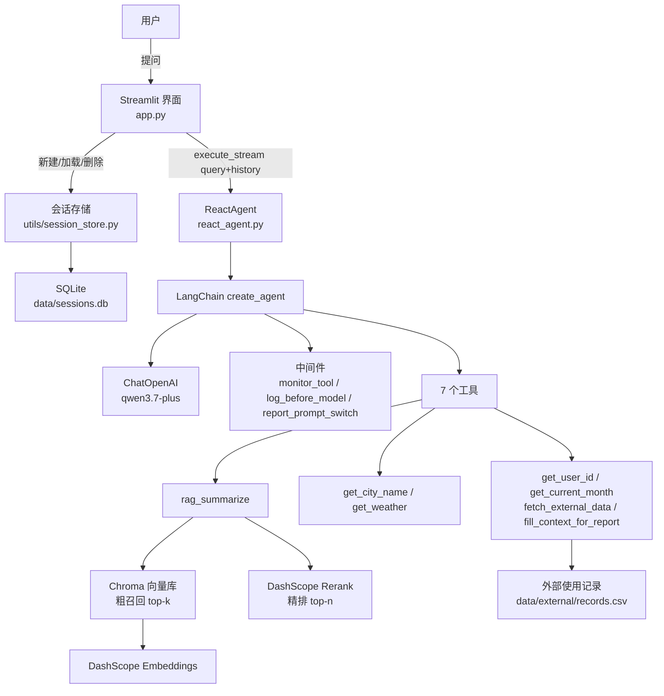
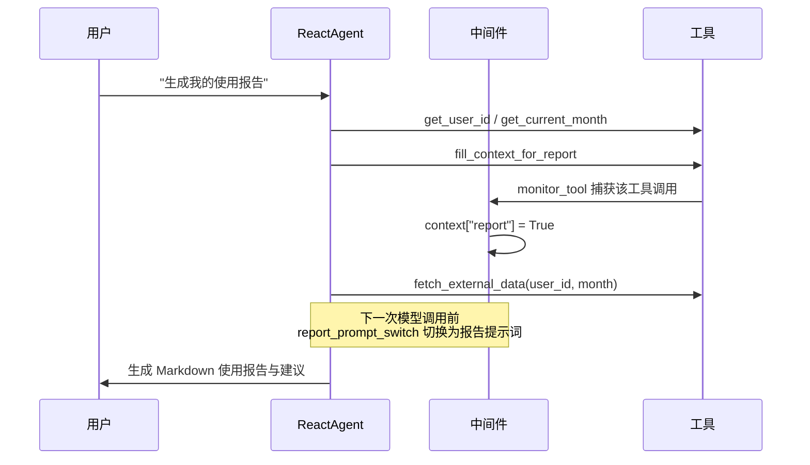

# Robot Vacuum Customer Service Agent

<p align="center">
  
  
  
  
  
</p>

<p align="center">
  基于 <b>LangChain ReAct Agent + RAG</b> 的扫地机器人智能客服系统<br>
  An intelligent customer-service agent for robot vacuums, built with LangChain, ReAct and RAG.
</p>

---

面向消费者（toC）的扫地机器人智能客服，覆盖产品全生命周期：售前咨询、售后使用指导、故障排查，以及基于使用数据的个性化报告生成。系统以通义千问（Qwen）为大脑，通过 ReAct 范式自主「思考 → 行动 → 观察 → 再思考」，按需调用工具并结合私有知识库（RAG）给出专业、可靠的回答。

## 功能特性

- **智能问答**：处理购买前咨询（功能、价格、对比）与购买后问题（操作、故障、维护），基于 RAG 从知识库检索准确信息作答。
- **使用报告生成**：分析用户使用记录（清洁效率、耗材状态、对比数据），生成个性化 Markdown 报告与优化建议。
- **ReAct 自主决策**：由大模型动态决定是否调用工具、调用哪个工具、是否继续迭代，而非写死的固定流程。
- **中间件增强**：工具调用监控日志、模型调用前日志，以及**报告场景下的提示词动态切换**。
- **增量知识库**：基于 MD5 去重，仅加载新增/变更文档，避免重复嵌入。
- **两段式检索**：向量粗召回 top-k + DashScope rerank 精排 top-n，提升参考资料相关性。
- **多轮会话管理**：基于 SQLite 持久化会话，侧边栏支持**新建 / 加载历史 / 删除（二次确认）**；将既往对话作为上下文传入 Agent，并以**滑动窗口截断**控制上下文长度，实现真正的多轮记忆。
- **流式交互**：Streamlit 聊天界面，逐字符流式输出。

## 系统架构



## 核心工作流程

报告生成场景通过中间件实现「问答人格」与「报告人格」的解耦：模型调用 `fill_context_for_report` 后，`monitor_tool` 将运行时上下文 `report` 置为 `True`，`@dynamic_prompt` 中间件在下一次模型调用前自动切换到报告提示词。



## 技术栈

| 领域 | 选型 |
|---|---|
| 智能体框架 | LangChain 1.4 `create_agent` + LangGraph |
| 大语言模型 | 通义千问 `qwen3.7-plus`（阿里云百炼，OpenAI 兼容端点 + `langchain-openai`） |
| 嵌入模型 | DashScope `qwen3.7-text-embedding` |
| 精排模型 | DashScope `qwen3.7-text-rerank` |
| 向量数据库 | Chroma |
| 检索增强 | RecursiveCharacterTextSplitter + 粗召回 Retriever + rerank 精排 + 总结链 |
| 会话存储 | SQLite（标准库 `sqlite3`，零额外依赖） |
| Web 界面 | Streamlit |
| 配置/提示词 | YAML 配置 + 独立提示词模板文件 |

## 项目结构

```
robot-vacuum-customer-service/
├── app.py                      # Streamlit 入口，聊天界面、会话侧边栏与流式输出
├── agent/
│   ├── react_agent.py          # ReactAgent：装配模型/工具/中间件，流式执行（支持多轮历史）
│   └── tools/
│       ├── agent_tools.py      # 7 个工具函数
│       └── middleware.py       # 3 个中间件（监控/日志/提示词切换）
├── model/
│   └── factory.py              # 模型工厂：ChatModel + EmbeddingModel
├── rag/
│   ├── rag_service.py          # 粗召回 + rerank 精排 + 总结服务
│   └── vector_store.py         # Chroma 向量库，MD5 增量加载文档
├── utils/
│   ├── cofig_handler.py        # YAML 配置加载
│   ├── prompt_loader.py        # 提示词加载
│   ├── file_handler.py         # PDF/TXT 加载、MD5、目录遍历
│   ├── logger_handler.py       # 统一日志
│   ├── path_tool.py            # 项目绝对路径工具
│   └── session_store.py        # SQLite 会话持久化（新建/加载/删除）
├── config/                     # YAML 配置（agent/rag/chroma/prompts）
├── prompts/                    # 提示词模板（主/RAG/报告）
├── evals/                      # 离线测评：dataset.jsonl 标注集 + run_eval.py，报告存 results/
├── data/                       # 知识库源文件（txt/pdf）+ 外部记录 csv + 会话库 sessions.db
├── docs/                       # 设计文档
├── requirements.txt
├── .env.example
├── LICENSE
└── README.md
```

> `chroma_db/`（向量库）、`logs/`（日志）、`md5_v2.text`（去重记录）、`data/sessions.db`（会话库）为运行时生成的产物，已在 `.gitignore` 中忽略；向量库可通过下方步骤从 `data/` 重建。

## 快速开始

### 环境要求

- Python 3.13+
- 一个阿里云百炼 DashScope API Key（用于 Qwen 模型与嵌入），[申请地址](https://bailian.console.aliyun.com/)

### 安装与运行

```bash
# 1. 克隆仓库
git clone https://github.com/MackMeng/robot-vacuum-customer-service.git
cd robot-vacuum-customer-service

# 2. 创建并激活虚拟环境
python -m venv .venv
# Windows:
.venv\Scripts\activate
# macOS/Linux:
source .venv/bin/activate

# 3. 安装依赖
pip install -r requirements.txt

# 4. 配置 API Key（当前版本从环境变量读取）
# Windows PowerShell:
$env:DASHSCOPE_API_KEY="sk-你的key"
# macOS/Linux:
export DASHSCOPE_API_KEY="sk-你的key"

# 5. 构建向量知识库（首次运行必须；会调用嵌入模型处理 data/ 下文档）
python -m rag.vector_store

# 6. 启动应用
streamlit run app.py
```

启动后浏览器访问 `http://localhost:8501` 即可对话。左侧边栏可**新建会话、加载历史对话、删除会话**（删除需二次确认）；对话自动持久化到本地 SQLite，刷新或重启后仍可加载，无需额外安装数据库服务。

> 提示：项目使用绝对导入且未包含 `__init__.py`，请在**项目根目录**运行；子模块用 `python -m rag.vector_store` 的模块方式执行，不要直接 `python rag/vector_store.py`。

## 配置说明

所有配置集中在 `config/`，与代码解耦：

| 文件 | 关键项 | 说明 |
|---|---|---|
| `rag.yaml` | `chat_model_name` / `embedding_model_name` / `chat_base_url` | 聊天与嵌入模型 ID、聊天模型兼容端点 |
| `chroma.yaml` | `collection_name` / `k` / `rerank_top_n` / `rerank_model_name` / `chunksize` / `chunk_overlap` / `separators` | 向量库、粗召回/精排数量、精排模型与分块策略 |
| `prompts.yaml` | `*_prompt_path` | 三套提示词模板的相对路径 |
| `agent.yaml` | `external_data_path` / `session_db_path` | 外部使用记录 CSV 路径 / 会话 SQLite 库路径 |

修改知识库：将新的 `.txt` / `.pdf` 放入 `data/`，重新运行 `python -m rag.vector_store` 即可增量入库（已处理文档按 MD5 跳过）。

## 离线测评（evals）

`evals/` 提供轻量离线测评，量化检索与回答质量，不引入额外评估框架：

```bash
python -m evals.run_eval                # 检索质量：关键词召回率 + 期望来源命中率（rerank 精排）
python -m evals.run_eval --no-rerank    # 基线对照：粗召回截断 top_n，量化 rerank 贡献
python -m evals.run_eval --with-answer  # 额外评估答案关键词覆盖率（多耗 API 调用）
```

- 标注集 `evals/dataset.jsonl`：每行一个用例（`query` / `keywords` / `source`），随代码进版本库，改知识库时同步维护；
- 报告带时间戳存入 `evals/results/`（已 gitignore），便于历次纵向对比；
- 纪律：换模型、调 `k`/分块、改提示词后重跑对照，指标不回退再上线。

## 使用示例

| 场景 | 示例提问 | 触发链路 |
|---|---|---|
| 选购咨询 | 「小户型适合哪些扫地机器人？」 | `rag_summarize` 检索知识库 |
| 环境适配 | 「我所在地区的气温下该如何保养？」 | `get_city_name` → `get_weather` → 综合作答 |
| 使用报告 | 「生成我的使用报告」 | `fill_context_for_report` → 提示词切换 → `fetch_external_data` |
| 多轮追问 | 「（承接上文）那适合养宠家庭吗？」 | 既往对话作为上下文传入 Agent |

## 说明与已知限制

本项目为学习/演示性质，以下工具为**模拟实现**，真实部署需替换为对应服务：

- `get_weather`：返回固定天气数据；
- `get_city_name` / `get_user_id` / `get_current_month`：随机返回演示值；
- `fetch_external_data`：读取本地 `records.csv` 演示数据。

此外，当前版本面向单机单用户、无鉴权；会话已持久化到本地 SQLite（`data/sessions.db`），支持跨刷新/重启加载；API Key 通过环境变量读取（未内置 `.env` 自动加载）。

## 后续规划

- [ ] 接入真实天气 API 与用户/设备系统
- [ ] `.env` 自动加载、多用户隔离与鉴权
- [ ] 单元测试与 CI
- [x] 检索重排（rerank）
- [x] 离线测评（evals：检索 A/B 对照 + 答案覆盖率）
- [ ] 答案引用溯源

## 许可证

[MIT](LICENSE) © 2026 MackMeng